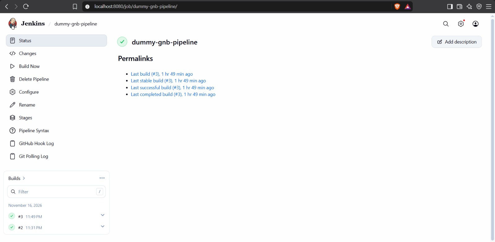

# Milestone 1 Implementation Report

## Architecture Setup
- **Source Control:** GitHub repository.
- **Automation Server:** Jenkins (running via Docker on Ubuntu WSL 2).
- **Containerization:** Docker.
- **Registry:** Local Docker registry (simulating GHCR/Docker Hub).

## Execution Flow
1. A `git push` to the `main` branch triggers the Jenkins webhook.
2. Jenkins pulls the latest code.
3. Jenkins executes the `Jenkinsfile`, building a Docker image of the dummy application.
4. The image is successfully built and tagged.

## Documentation
Github Container Registry:

Jenkins:

