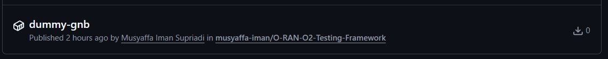

# Milestone 1 Implementation Report: GitOps Automated Pipeline

**Project:** O-RAN O2 Testing Framework Duplication  
**Reference:** Master's Thesis of Yosafat Marselino Agus (NTUST, 2026), Section 3.2  
**Author:** Musyaffa Iman  
**Date:** November 2026  
**Status:** Completed & Verified  

---

## 1. Executive Summary

Milestone 1 establishes the **GitOps Automated CI/CD Pipeline**, serving as the foundation of the platform-agnostic O-RAN testing framework. The goal is to automate the build, containerization, and release lifecycle of RAN software (simulated in this phase using a lightweight dummy gNB application) upon code commits, pushing standardized container images to an Image Registry without manual intervention.

This report documents every step undertaken to design, configure, implement, and verify this pipeline under local hardware constraints.

---

## 2. Environment & System Specifications

To develop sustainably within local resource limitations (avoiding resource-heavy full clusters during the initial phase), the environment was configured as follows:

| Component | Specification / Tool | Purpose |
| :--- | :--- | :--- |
| **Host Machine** | Windows 10 (Intel Core i7-7700HQ 4C/8T, 16GB RAM) | Development workstation |
| **Virtualization** | WSL 2 (Ubuntu 26.04 LTS on Drive D) | Native Linux environment for container runtime |
| **Container Engine**| Docker Engine v29.1.3 (installed natively inside WSL 2) | Lightweight container engine (bypasses Docker Desktop overhead) |
| **Automation Server**| Jenkins LTS (running as a Docker container) | Orchestrates the GitOps build and release pipeline |
| **Container Registry**| GitHub Container Registry (`ghcr.io`) | OCI-compliant registry hosting the built gNB images |
| **Source Control** | Git & GitHub (`musyaffa-iman/O-RAN-O2-Testing-Framework`) | Single source of truth for code and manifests |

---

## 3. Step-by-Step Implementation

### Step 1: Developing the Dummy gNB Workload
Because actual gNB source code (OAI / srsRAN) requires significant compilation resources and lab licenses, a dummy containerized application was created to represent the gNB workload:
1. **Application Logic (`index.html`):** Created a responsive landing page displaying simulated gNB VNF emulation status, version metadata, and target cloud indicators.
2. **Containerization (`Dockerfile`):** 
   - Based on minimal `nginx:alpine` to keep image size small (<50 MB).
   - Configured document root `/usr/share/nginx/html/index.html`.
   - Exposed HTTP port `80` with built-in health check probes (`wget --spider`).

### Step 2: Setting up Native Docker & Jenkins in WSL 2
1. **Docker Engine Installation:**
   - Updated package repositories inside Ubuntu WSL 2 and installed `docker.io` and `containerd`.
   - Added user `musy` to the `docker` group to enable non-root Docker execution.
   - Verified active systemd service: `systemctl status docker`.
2. **Jenkins Container Deployment:**
   - Created a persistent volume: `docker volume create jenkins_home`.
   - Deployed the official `jenkins/jenkins:lts` container with **Docker-outside-of-Docker (DooD)** architecture by mounting the host Docker Unix socket:
     ```bash
     docker run -d \
       --name jenkins \
       --restart unless-stopped \
       -p 8080:8080 \
       -p 50000:50000 \
       -v jenkins_home:/var/jenkins_home \
       -v /var/run/docker.sock:/var/run/docker.sock \
       -u root \
       jenkins/jenkins:lts
     ```
3. **Docker CLI Integration Inside Jenkins:**
   - Installed the Docker CLI client binary inside the running Jenkins container so that pipeline shell scripts can directly invoke `docker build`, `docker tag`, and `docker push`.
4. **Access Verification:**
   - Verified web access from Windows 10 host at `http://localhost:8080`.
   - Retrieved initial unlock key from `/var/jenkins_home/secrets/initialAdminPassword`.
   - Completed the setup wizard and installed suggested plugins plus the **Docker Pipeline** and **GitHub Integration** plugins.

### Step 3: Authoring the Declarative Pipeline (`Jenkinsfile`)
Authored a declarative `Jenkinsfile` at the repository root structured into structured execution stages:
* **Stage 1: Checkout Source:** Clones the targeted commit from the GitHub repository.
* **Stage 2: Build Docker Image:** Executes `docker build`, tagging the image with both the Jenkins `${env.BUILD_NUMBER}` and `latest`:
  ```bash
  docker build -t ghcr.io/musyaffa-iman/dummy-gnb:${env.BUILD_NUMBER} \
               -t ghcr.io/musyaffa-iman/dummy-gnb:latest .
  ```
* **Stage 3: Verify Image:** Inspects image metadata and confirms binary integrity.
* **Stage 4: Push to GHCR:** Authenticates securely against `ghcr.io` using Jenkins credentials (`withCredentials`) and pushes both tags:
  ```bash
  echo "$REGISTRY_TOKEN" | docker login "$REGISTRY" -u "$REGISTRY_USER" --password-stdin
  docker push ghcr.io/musyaffa-iman/dummy-gnb:${BUILD_NUMBER}
  docker push ghcr.io/musyaffa-iman/dummy-gnb:latest
  docker logout "$REGISTRY"
  ```
* **Cloud Fallback (`.github/workflows/deploy.yml`):** Implemented an equivalent GitHub Actions workflow as an alternative zero-local-overhead pipeline.

### Step 4: Configuring Registry Credentials
1. Generated a GitHub **Personal Access Token (PAT Classic)** with permissions:
   - `write:packages` (upload packages to GHCR)
   - `read:packages` (download packages)
   - `repo` (access repository metadata)
2. Stored the token in Jenkins Credential Manager:
   - **Type:** Username with password
   - **ID:** `ghcr-credentials`
   - **Username:** `musyaffa-iman`
   - **Password:** `<GITHUB_PAT>`

### Step 5: Configuring the Automated GitOps Trigger (Poll SCM)
To trigger the build automatically upon each `git push` without requiring external tunneling daemons (such as ngrok or Cloudflare Tunnel) that consume additional RAM:
1. Configured the Jenkins Pipeline job with **Poll SCM**.
2. Scheduled the polling frequency with cron syntax:
   ```text
   * * * * *
   ```
   *(Jenkins queries the GitHub repository every 60 seconds for new commit hashes).*

### Step 6: End-to-End Pipeline Verification
1. Modified `index.html` and documentation to trigger a new commit.
2. Committed and pushed the changes to the remote branch:
   ```bash
   git commit -m "feat(milestone1): update vnf version and mark milestone 1 complete"
   git push origin main
   ```
3. Observed the Jenkins dashboard:
   - Within 60 seconds, Poll SCM detected commit `873d963`.
   - Jenkins autonomously initiated build `#3`.
   - All stages (`Checkout`, `Build`, `Verify`, `Push`) passed with status **SUCCESS**.
   - The package was successfully published to `ghcr.io/musyaffa-iman/dummy-gnb:latest`.

---

## 4. Verification & Artifacts

### 4.1 GitHub Container Registry (GHCR) Verification
The published container image package in GitHub Container Registry showing tags and release metadata:



### 4.2 Jenkins Pipeline Execution & Stage View
The Jenkins dashboard displaying successful declarative pipeline execution, build history, and stage durations:


---

## 5. Engineering Challenges & Solutions

| Challenge | Root Cause | Engineering Solution |
| :--- | :--- | :--- |
| **16GB Host RAM Limitation** | Full StarlingX / OKD clusters require 32GB+ RAM. | Implemented a phased strategy: used native Docker inside WSL 2 with Alpine-based dummy gNB workloads, deferring heavy clusters to Phase B (Remote Lab / AWS). |
| **Docker-in-Docker CLI Missing** | Standard `jenkins/jenkins:lts` image does not bundle the Docker client CLI. | Mounted `/var/run/docker.sock` to use host Docker daemon (DooD) and installed Docker CLI inside the container, avoiding nested daemon overhead. |
| **Local Webhook Inaccessibility** | Localhost is behind NAT; GitHub cloud cannot send webhooks directly without external tunnel. | Implemented Jenkins **Poll SCM** (`* * * * *`), eliminating external network tunnel dependencies and zero additional RAM usage. |

---

## 6. Milestone 1 Completion Checklist

- [x] **Git Repository Setup:** Single source of truth configured at `musyaffa-iman/O-RAN-O2-Testing-Framework`.
- [x] **Automated Triggering:** Jenkins monitors the repository for changes via Poll SCM.
- [x] **Container Build Pipeline:** Declarative `Jenkinsfile` packages the dummy gNB into an OCI container.
- [x] **Image Registry Publishing:** Container images pushed to GitHub Container Registry (`ghcr.io`).
- [x] **Success Criteria Satisfied:** A `git push` automatically triggers a complete build and publish cycle with zero manual intervention.

---

## 7. Next Step: Transition to Milestone 2

With the automated delivery pipeline established, the next phase focuses on **Milestone 2: O2 Interface Abstraction**:
* **FOCOM Module (O2 IMS):** Implement REST API (`GET /cloud/resource`) for cloud resource and accelerator discovery.
* **NFO Module (O2 DMS):** Implement REST API (`POST /vnf/create`, `POST /vnf/terminate`) to deploy and manage the `dummy-gnb` container image across O-Cloud platforms.
